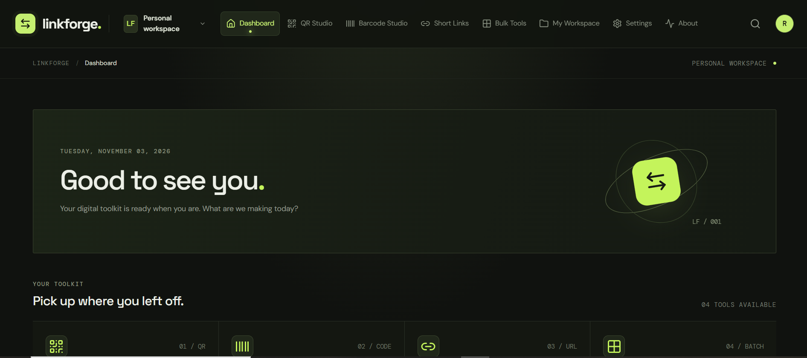
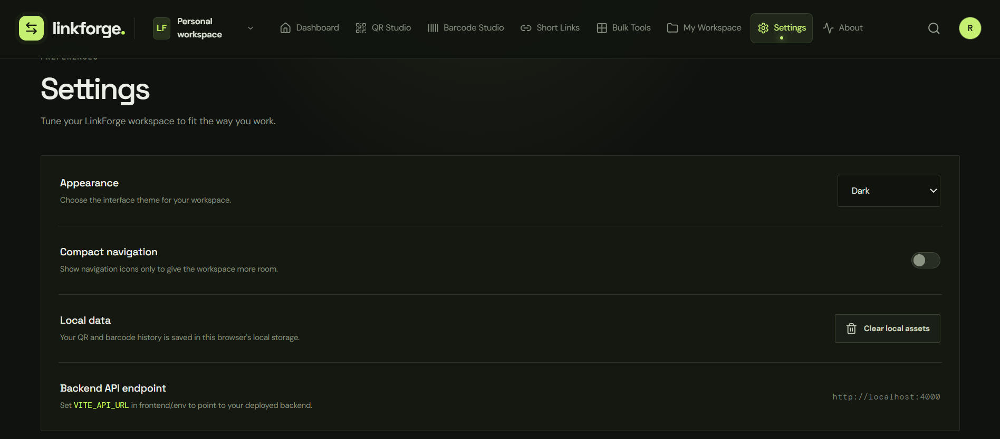
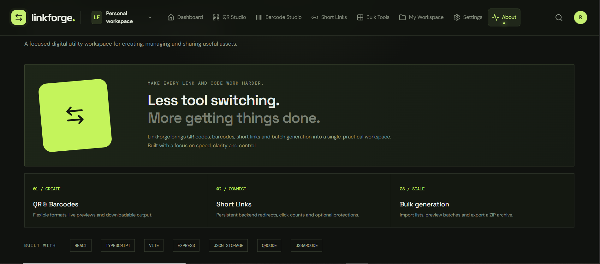

<div align="center">

# 🔗 LinkForge

### Generate. Connect. Organize.

A modern, all-in-one digital utility platform for generating, customizing, and managing QR codes, barcodes, and short links.

<br>



<br>


</div>

---

# 🖥️ Application Preview

LinkForge provides an integrated workspace with dedicated tools for generating, customizing, organizing, and managing digital assets.

<table>
  <tr>
    <td align="center" width="50%">
      
      <br>
      <b>01. Dashboard</b>
      <br>
      <sub>Centralized overview of tools, activity, and workspace information.</sub>
    </td>
    <td align="center" width="50%">
      
      <br>
      <b>02. QR Studio</b>
      <br>
      <sub>Create and customize QR codes for different types of content.</sub>
    </td>
  </tr>
  <tr>
    <td align="center" width="50%">
      
      <br>
      <b>03. Barcode Studio</b>
      <br>
      <sub>Generate barcode assets from supported data formats.</sub>
    </td>
    <td align="center" width="50%">
      
      <br>
      <b>04. Short Links</b>
      <br>
      <sub>Create, manage, and monitor shortened URLs.</sub>
    </td>
  </tr>
  <tr>
    <td align="center" width="50%">
      
      <br>
      <b>05. Bulk Tools</b>
      <br>
      <sub>Generate multiple QR codes and barcodes through bulk processing.</sub>
    </td>
    <td align="center" width="50%">
      
      <br>
      <b>06. My Workspace</b>
      <br>
      <sub>Organize generated assets, saved items, and previous activity.</sub>
    </td>
  </tr>
  <tr>
    <td align="center" width="50%">
      
      <br>
      <b>07. Settings</b>
      <br>
      <sub>Manage application preferences and workspace settings.</sub>
    </td>
    <td align="center" width="50%">
      
      <br>
      <b>08. About</b>
      <br>
      <sub>Explore information about LinkForge and its development.</sub>
    </td>
  </tr>
</table>

---

# 📌 Overview

Digital tools such as QR codes, barcodes, and shortened URLs are widely used for sharing information, organizing resources, managing products, and connecting users to online content.

However, switching between different applications to generate and manage these resources can make everyday workflows less convenient.

**LinkForge** was developed to bring these utilities together in one centralized platform.

It provides dedicated workspaces for QR code generation, barcode creation, and URL shortening, allowing users to create and manage digital assets through a consistent interface.

The platform also includes bulk generation tools, downloadable outputs, workspace management, and short-link analytics.

By combining these capabilities, LinkForge provides a convenient environment for creating, organizing, and managing commonly used digital resources.

**Its central principle is simple: create, customize, manage, and connect through one unified workspace.**

---

# ✨ Features

- 🔗 **QR Code Generator** — Create QR codes for supported content types, including URLs and other information.
- 🎨 **QR Code Customization** — Personalize QR code appearance through available design and styling options.
- 📥 **QR Code Downloads** — Export generated QR codes in supported image formats, including PNG and SVG.
- 🏷️ **Barcode Generator** — Generate barcodes using supported barcode formats and input data.
- 📦 **Bulk Generation** — Generate multiple QR codes and barcodes from supported bulk input.
- 📄 **CSV and TXT Support** — Import lists of data for bulk processing.
- 🗜️ **ZIP Export** — Download generated bulk assets together in a convenient archive.
- 🔗 **Short Link Management** — Create shortened URLs through the application's backend.
- 📊 **Link Analytics** — Review available activity information and statistics for shortened links.
- ↪️ **URL Redirection** — Redirect users from generated short links to their original destinations.
- 🗂️ **My Workspace** — Access and organize saved assets and previous activity.
- ⭐ **Favorites Management** — Keep frequently used or important generated items accessible.
- 🕘 **Activity History** — Review previously generated content and available records.
- ⚙️ **Application Settings** — Manage available preferences and interface settings.
- 📊 **Dashboard Overview** — Access important tools and workspace information from one central location.
- 🎨 **Modern User Interface** — Use a polished, dark-themed interface with a distinctive visual identity.
- 📱 **Responsive Design** — Adapt the interface to different screen sizes and devices.

---

# 🧭 Main Application Sections

LinkForge is organized into dedicated sections, each serving a particular purpose.

## 01. Dashboard — Central Overview

The Dashboard serves as the main entry point of LinkForge.

It provides an overview of the application's available tools, workspace activity, and important information.

Users can access the different utilities without navigating through unrelated applications.

Its purpose is to provide a centralized starting point for everyday digital asset management.

## 02. QR Studio — QR Code Generation

QR Studio allows users to create QR codes for supported types of content.

Users can enter their desired information, configure available customization options, and generate a corresponding QR code.

Depending on the available settings, generated QR codes can be personalized and downloaded in supported formats.

This section is designed to make QR code creation accessible and convenient.

## 03. Barcode Studio — Barcode Generation

Barcode Studio provides a dedicated environment for creating barcodes.

Users can enter supported data and select from the available barcode formats.

The generated barcode can then be reviewed and exported through the available download options.

This section is intended for users who need to create barcode assets for identification, organization, and other supported applications.

## 04. Short Links — URL Management

The Short Links section allows users to convert long URLs into shorter, more manageable links.

Generated short links can be used for sharing and accessing their original destinations through URL redirection.

The section also provides available management and analytics features for reviewing link activity.

Its purpose is to simplify URL sharing while keeping link management organized.

## 05. Bulk Tools — Batch Generation

Bulk Tools allows users to process multiple entries instead of generating each asset individually.

Users can provide supported data through available input methods, including CSV or TXT files.

The application processes the supplied entries and generates the corresponding QR codes or barcodes.

Where supported, generated assets can be downloaded together through ZIP export.

This section is particularly useful when working with larger collections of data.

## 06. My Workspace — Personal Asset Management

My Workspace provides a centralized area for accessing generated assets and saved information.

Depending on the available functionality, users can review previous activity, manage favorites, and access stored items.

It helps keep generated resources organized and easier to retrieve.

## 07. Settings — Application Preferences

The Settings section provides access to available application preferences.

Users can manage supported interface and workspace settings to configure their LinkForge experience.

## 08. About — Project Information

The About section presents information about LinkForge, its purpose, and its development.

It provides users with an introduction to the application and its intended functionality.

---

# 🛠️ Technologies Used

LinkForge uses modern web development technologies to deliver its frontend interface and backend functionality.

## Frontend Development

- **React** — Builds the interactive user interface through reusable components.
- **TypeScript** — Provides static typing and improves code organization and maintainability.
- **Vite** — Provides the frontend development environment and build tooling.
- **CSS** — Handles application styling, responsive layouts, transitions, and visual presentation.

## Backend Development

- **Node.js** — Provides the JavaScript runtime for backend operations.
- **Express.js** — Handles backend routes, application requests, and URL redirection.
- **JSON-based Persistence** — Supports local data storage where implemented in the current build.

## Application Capabilities

- QR code generation and customization.
- Barcode generation.
- Short URL creation and redirection.
- Link activity tracking.
- Bulk data processing.
- File import and export.
- Workspace and history management.

## Development Tools

- Visual Studio Code.
- Git.
- GitHub.
- Node.js and npm.
- Modern web browsers.

---

# 🚀 Installation and Setup

Follow these instructions to download and run LinkForge locally.

## Prerequisites

Before running the project, ensure that you have:

- **Node.js** — Required for running the frontend and backend development environments.
- **npm** — Included with Node.js for installing project dependencies.
- **Visual Studio Code** — Recommended code editor.
- **Git** — Required if you intend to clone the repository.
- **Modern Web Browser** — For accessing and testing the application.

## 1. Clone the Repository

Replace `your-username` with your GitHub username if you are using a fork.

```bash
git clone https://github.com/rheillunio2-byte/LinkForge.git
```

## 2. Navigate to the Project Folder

```bash
cd LinkForge
```

## 3. Open the Project in Visual Studio Code

```bash
code .
```

Alternatively, open Visual Studio Code manually and select the LinkForge project folder.

## 4. Install Dependencies

Install the dependencies for the frontend:

```bash
npm install --prefix frontend
```

Install the dependencies for the backend:

```bash
npm install --prefix backend
```

If the repository provides a root-level installation script or a different setup procedure, follow the instructions included with the current project files.

## 5. Configure Environment Variables

Check the backend configuration for any required environment variables.

If the project includes an `.env.example` file, create a local `.env` file using the provided template.

Do not commit private environment variables, credentials, or secrets to GitHub.

## 6. Start the Application

Start the frontend and backend using the development commands defined in their respective `package.json` files.

For example, if the configured scripts use Vite and Node.js:

Frontend:

```bash
cd frontend
npm run dev
```

Backend:

```bash
cd backend
npm run dev
```

If the project includes Windows setup scripts, you may also use the provided installation and startup batch files.

## 7. Open LinkForge

Once the development servers are running, open the local frontend address displayed in your terminal.

The application should now be accessible through your browser.

**Note:** The exact commands and local addresses depend on the scripts and configuration included in the current repository.

---

# 📖 How to Use LinkForge

## 1. Open the Dashboard

Launch LinkForge through your browser.

The Dashboard provides access to the application's primary sections:

- Dashboard.
- QR Studio.
- Barcode Studio.
- Short Links.
- Bulk Tools.
- My Workspace.
- Settings.
- About.

Use the navigation system to access the tool you need.

## 2. Generate a QR Code

Navigate to **QR Studio**.

Enter the information you want to encode and select the available content type.

Configure the available customization settings and generate your QR code.

Review the generated result and download it using one of the supported export formats.

## 3. Generate a Barcode

Navigate to **Barcode Studio**.

Enter the data you want to encode and choose an available barcode format.

Generate the barcode and review the result.

Use the available download functionality to save the generated asset.

## 4. Create a Short Link

Navigate to **Short Links**.

Enter the original URL you want to shorten.

Submit the URL through the available creation interface.

Once successfully created, the application provides a shortened link that can be copied and shared.

Use the available management and analytics features to review your links and their activity.

## 5. Generate Multiple Assets

Navigate to **Bulk Tools**.

Choose the type of asset you want to generate.

Provide your entries using the supported input method, such as CSV or TXT.

Start the generation process and review the resulting assets.

If available, use ZIP export to download the generated files together.

## 6. Manage Your Workspace

Navigate to **My Workspace**.

Review available generated items, saved assets, favorites, and previous activity.

Use the available workspace controls to organize and access your resources.

## 7. Configure Application Settings

Navigate to **Settings**.

Review the available preferences and adjust the application configuration as supported.

---

# 🔍 Understanding the Core Tools

## QR Codes

A Quick Response (QR) code is a two-dimensional barcode that stores information in a machine-readable pattern.

QR codes can represent different types of information, depending on the content encoded into them.

LinkForge provides a dedicated environment for creating and customizing supported QR code types.

## Barcodes

Barcodes represent information through patterns that can be interpreted by compatible scanning devices.

Different barcode formats support different data structures and use cases.

LinkForge provides barcode generation functionality through its Barcode Studio.

## Short Links

Short links provide a compact alternative to long URLs.

Instead of sharing an entire destination address, users can share a shorter URL that redirects to the original destination.

LinkForge provides short-link creation and management functionality through its backend.

## Bulk Generation

Bulk generation allows users to process multiple entries in one operation.

Rather than creating each QR code or barcode individually, users can provide a collection of data and generate multiple assets through a single workflow.

Supported import and export options help make this process more convenient.

---

# ⚙️ Core Modules

LinkForge is organized into several functional modules.

- **Dashboard Module:** Provides the main overview and navigation experience.
- **QR Generation Module:** Handles QR code creation and supported content types.
- **QR Customization Module:** Manages available QR code appearance options.
- **Barcode Generation Module:** Handles barcode creation using supported formats.
- **Short Link Module:** Creates and manages shortened URLs.
- **Redirection Module:** Handles requests to generated short links and redirects users to their destinations.
- **Analytics Module:** Processes and presents available short-link activity information.
- **Bulk Processing Module:** Handles multiple QR code and barcode generation requests.
- **File Import Module:** Processes supported CSV and TXT input files.
- **Export Module:** Provides supported downloads, including individual assets and ZIP archives.
- **Workspace Module:** Organizes generated assets, favorites, and available history.
- **Settings Module:** Manages supported application preferences.
- **Interface Module:** Handles navigation, visual components, interactions, and responsive presentation.

---

# 📂 Project Structure

The project is organized into separate frontend and backend components.

```text
LinkForge/
│
├── frontend/
│   ├── public/
│   ├── src/
│   │   ├── components/
│   │   ├── pages/
│   │   ├── assets/
│   │   └── ...
│   ├── package.json
│   └── ...
│
├── backend/
│   ├── ...
│   └── package.json
│
├── images/
│   ├── About.PNG
│   ├── Barcode Studio.PNG
│   ├── Bulk Tools.PNG
│   ├── Dashboard.PNG
│   ├── My Workspace.PNG
│   ├── QR Studio.PNG
│   ├── Settings.PNG
│   └── Short Links.PNG
│
├── README.md
├── CONTRIBUTING.md
├── LICENSE
└── .gitignore
```

### File and Folder Descriptions

| File / Folder | Purpose |
|---|---|
| `frontend/` | Contains the client-side application. |
| `frontend/src/` | Contains frontend source code and application components. |
| `frontend/public/` | Contains public assets served by the frontend, where included. |
| `backend/` | Contains server-side application logic and API routes. |
| `images/` | Contains screenshots used in project documentation. |
| `images/About.PNG` | Screenshot of the About section. |
| `images/Barcode Studio.PNG` | Screenshot of Barcode Studio. |
| `images/Bulk Tools.PNG` | Screenshot of Bulk Tools. |
| `images/Dashboard.PNG` | Screenshot of the main Dashboard. |
| `images/My Workspace.PNG` | Screenshot of My Workspace. |
| `images/QR Studio.PNG` | Screenshot of QR Studio. |
| `images/Settings.PNG` | Screenshot of Settings. |
| `images/Short Links.PNG` | Screenshot of Short Links. |
| `README.md` | Project overview, installation instructions, and documentation. |
| `CONTRIBUTING.md` | Guidelines for contributing to the project. |
| `LICENSE` | Contains the project's license. |
| `.gitignore` | Specifies files and folders excluded from Git tracking. |

*Note: The structure above is a simplified documentation example. Retain the actual filenames and folders present in your repository when updating this section.*

---

# 🧪 Testing

When making changes to LinkForge, test the application to ensure that existing functionality remains intact.

Important areas to verify include:

- Navigation between all application sections.
- QR code generation.
- QR code customization.
- QR code PNG and SVG exports.
- Barcode generation.
- Supported barcode formats.
- Short-link creation.
- Short-link redirection.
- Link analytics and activity tracking.
- Bulk QR code generation.
- Bulk barcode generation.
- CSV and TXT imports.
- ZIP exports.
- Workspace functionality.
- Favorites and history management.
- Settings and saved preferences.
- Responsive interface behavior.
- Error handling for invalid or unsupported input.
- Frontend and backend communication.

If the repository includes automated tests, run them using the commands provided in the project's testing configuration.

---

# ⚠️ Limitations and Important Notes

LinkForge is designed as a digital utility platform. Its capabilities depend on the functionality implemented in the current application build.

The following considerations should be kept in mind:

- QR code and barcode generation depend on the supported input formats and available generation libraries.
- Not every barcode format supports the same types of information.
- Generated QR codes and barcodes should be tested with compatible scanning applications or devices.
- Short links depend on the availability of the backend service.
- Link redirection requires the backend to be accessible.
- Analytics reflect the activity that the application is configured to collect.
- Bulk processing may be affected by file size, entry count, and browser or server resource limitations.
- Imported CSV and TXT files should follow the expected input format.
- Workspace persistence depends on the application's configured storage mechanism.
- Exported assets should be reviewed before being used in production workflows.

LinkForge is intended to simplify digital asset generation and management. It should not be considered a replacement for specialized enterprise link management, inventory, or analytics systems.

---

# 🔮 Future Improvements

Potential future enhancements for LinkForge include:

- Additional QR code content types.
- More QR code customization options.
- Expanded barcode format support.
- Additional export formats.
- Improved bulk generation performance.
- More advanced short-link analytics.
- Custom short-link aliases.
- Enhanced workspace organization.
- Improved search and filtering.
- Additional asset management options.
- More detailed usage statistics.
- Improved accessibility and keyboard navigation.
- Additional interface customization.
- Expanded automated testing.
- Improved backend data management.

These are proposed improvements and are not necessarily available in the current version.

---

# 🤝 Contributing

Contributions, suggestions, bug reports, documentation updates, and feature improvements are welcome.

If you would like to contribute to LinkForge, please read [CONTRIBUTING.md](CONTRIBUTING.md) for information about development requirements, coding standards, testing, and submitting changes.

---

# 📄 License

This project is distributed under the MIT License.

See the [LICENSE](https://github.com/rheillunio2-byte/LinkForge?tab=MIT-1-ov-file) file for the applicable terms and conditions.

---

<div align="center">

# 🔗 LinkForge

### Generate. Connect. Organize.

**Bringing QR codes, barcodes, and short links together in one unified digital workspace.**

</div>
